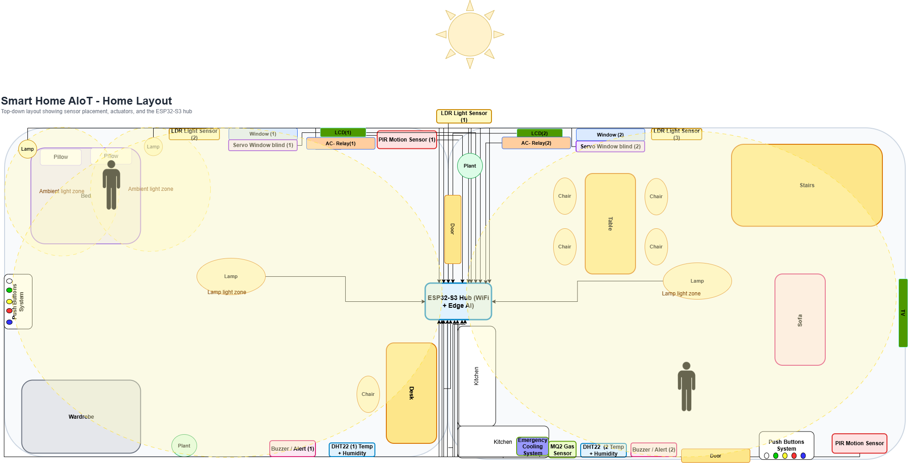
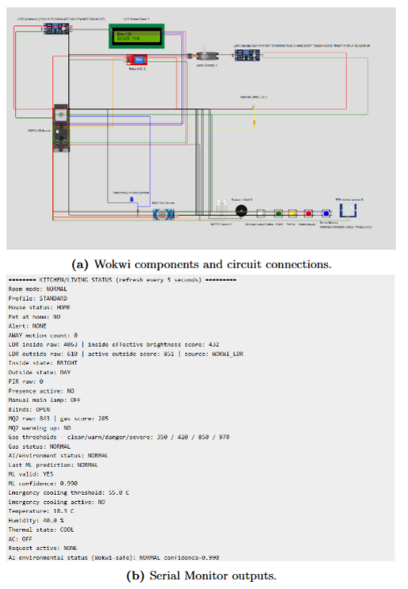
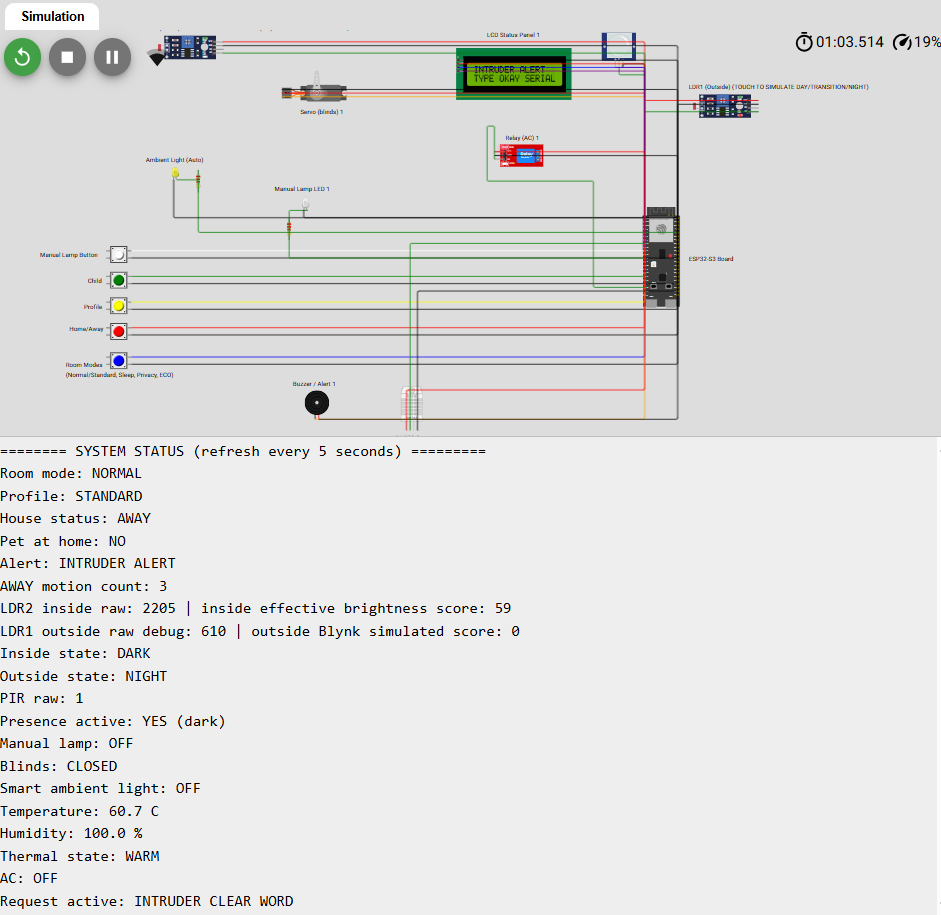
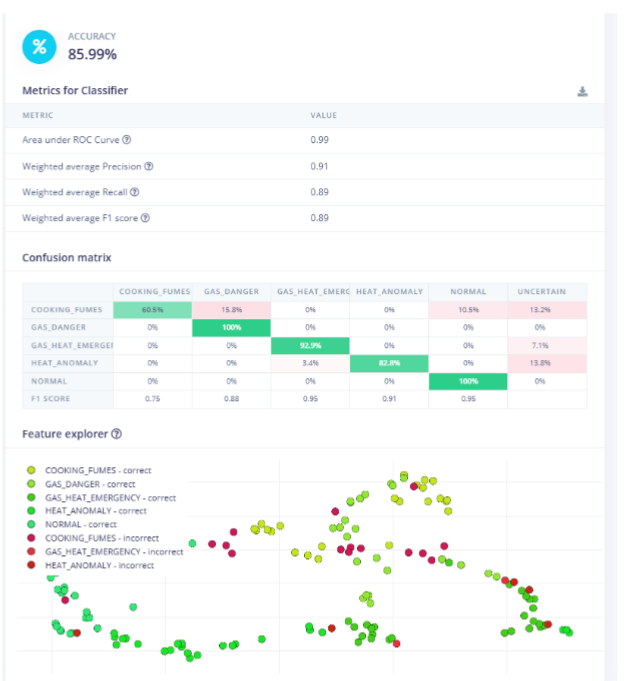
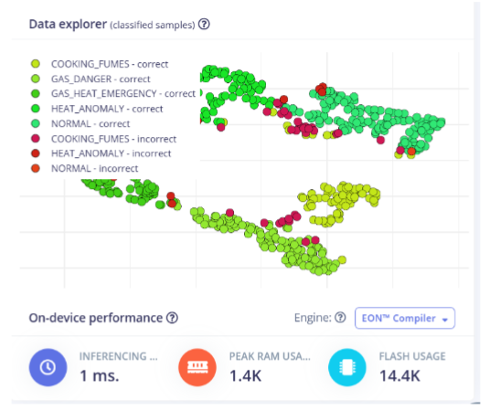
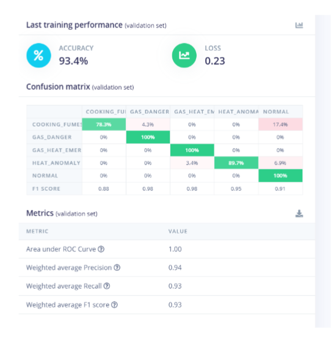

<p align="center">
  
</p>

<h1 align="center">AIoT Smart Home ESP32-S3</h1>

<p align="center">
  Simulation-based ESP32-S3 smart-home prototype combining Wokwi, Blynk, deterministic automation and a transparent TinyML experimentation path.
</p>

<p align="center">
  <a href="https://wokwi.com/projects/465661521735358465">Bedroom Wokwi Demo</a> ·
  <a href="https://wokwi.com/projects/465661368262601729">Kitchen/Living Room Wokwi Demo</a> ·
  <a href="report/aiot_smart_home_public_report.pdf">Technical Report</a> ·
  <a href="docs/REPRODUCIBILITY.md">Reproducibility Notes</a>
</p>

---

## Overview

This repository presents a **simulation-based AIoT smart-home prototype** built around two ESP32-S3 room controllers.

It demonstrates:

- embedded Arduino/C++ programming;
- sensor/actuator orchestration in Wokwi;
- local comfort, privacy, security and environmental-safety logic;
- Blynk dashboard integration;
- a synthetic environmental dataset;
- an Edge Impulse / TinyML experimentation workflow;
- explicit separation between deterministic safety behaviour and ML experimentation;
- reproducibility checks and CI for the public repository.

The project is an academic/portfolio prototype. It is **not a production safety system**, and the TinyML results are not presented as real-world hazard-detection validation.

---

## Recruiter Snapshot

| Area | Evidence in this repository |
|---|---|
| Embedded systems | Two ESP32-S3 Arduino sketches with room-level state/control logic |
| IoT simulation | Public Wokwi demos for Bedroom and Kitchen/Living Room modules |
| Cloud/dashboard integration | Blynk virtual-pin monitoring and interaction |
| Safety-state modelling | Gas, heat, occupancy and escalation logic with deterministic fallback |
| TinyML workflow | Synthetic dataset, Edge Impulse training/test evidence and optional inference integration point |
| Reproducibility | Dataset/rule validator plus GitHub Actions quality checks |
| Documentation | Architecture visuals, module notes and sanitised technical report |

### What the ML result does — and does not — show

The environmental dataset is **simulated and rule-labelled**. Labels are generated from demonstration thresholds using the same synthetic variables supplied to the model. Strong classifier performance is therefore expected: it shows that an embedded-ML workflow can learn the designed decision regions, not that the model has independently discovered real household hazards.

Real-world validation would require physical sensors, calibration, independently labelled data, hardware measurements and a safety review.

See [`docs/REPRODUCIBILITY.md`](docs/REPRODUCIBILITY.md) for the full evaluation protocol and caveats.

---

## Live Demos

| Component | Link | Purpose |
|---|---|---|
| Bedroom | [Open in Wokwi](https://wokwi.com/projects/465661521735358465) | Lighting, blinds, comfort, profiles and Home/Away security |
| Kitchen/Living Room | [Open in Wokwi](https://wokwi.com/projects/465661368262601729) | Gas/heat monitoring, emergency logic and Blynk interaction |
| 2D/3D house model | [Open Planner 5D](https://planner5d.onelink.me/stDT/wjmc3u8i) | Visual layout of the smart-home concept |
| Technical report | [Open PDF](report/aiot_smart_home_public_report.pdf) | Design, implementation, evaluation and limitations |

---

## Architecture

```text
Smart Home Prototype
│
├── Bedroom ESP32-S3
│   ├── PIR occupancy
│   ├── indoor/outdoor light sensing
│   ├── DHT22 temperature/humidity
│   ├── servo-controlled blinds
│   ├── PWM lighting
│   ├── AC relay + LCD
│   ├── profile/privacy logic
│   └── Home/Away security state
│
└── Kitchen/Living Room ESP32-S3
    ├── MQ2 gas input
    ├── DHT22 temperature/humidity
    ├── PIR occupancy
    ├── visual/audible alerts
    ├── emergency cooling indicator
    ├── Blynk dashboard
    ├── deterministic safety rules
    └── optional Edge Impulse inference layer
```

The deterministic path remains authoritative in the public simulation. The optional ML path is treated as an experiment and never as the sole basis for a safety-critical action.

---

## Bedroom Module

Location: [`wokwi/bedroom/`](wokwi/bedroom/)

Main behaviours:

- Normal, Sleep, Privacy and Eco modes;
- Standard, Elderly and Child profiles;
- adaptive lighting using indoor/outdoor brightness;
- servo-controlled blind automation;
- PIR-based occupancy tracking;
- temperature/humidity monitoring;
- AC relay logic with hysteresis;
- Home/Away state;
- suspicious-motion and intruder escalation;
- demonstration-only authentication/recovery flows.

The public sketch uses placeholder Blynk credentials and Wokwi's simulated Wi-Fi network.

---

## Kitchen / Living Room Module

Location: [`wokwi/kitchen-living-room/`](wokwi/kitchen-living-room/)

Main behaviours:

- MQ2-based simulated gas monitoring;
- DHT22 temperature/humidity sensing;
- gas warning/danger persistence logic;
- heat anomaly and gas+heat emergency states;
- buzzer and visual alerts;
- Blynk dashboard updates;
- deterministic fallback safety logic;
- optional Edge Impulse classifier integration.

The public build keeps the generated Edge Impulse runtime disabled by default:

```cpp
#define USE_EDGE_IMPULSE_RUNTIME 0
```

This makes the Wokwi simulation runnable and auditable without a proprietary/generated deployment package.

---

## TinyML / Edge Impulse Experiment

### Dataset

[`data/environmental_training_dataset.csv`](data/environmental_training_dataset.csv) contains:

- `gas_score` — simulated MQ2 score, 0–1000;
- `temperature` — simulated DHT22 temperature in °C;
- `humidity` — simulated relative humidity in %;
- `label` — one of five environmental states.

Synthetic labels are generated from demonstration rules:

| Rule | Label |
|---|---|
| `gas_score >= 850` and `temperature >= 55°C` | `GAS_HEAT_EMERGENCY` |
| `gas_score >= 850` | `GAS_DANGER` |
| `temperature >= 55°C` | `HEAT_ANOMALY` |
| `gas_score >= 420` | `COOKING_FUMES` |
| otherwise | `NORMAL` |

These are **not calibrated safety thresholds**. Humidity is included as an input feature but does not determine the synthetic ground-truth label in this experiment.

### Model evidence

The repository retains Edge Impulse training/test screenshots under [`assets/`](assets/) so the experiment remains inspectable.

A generated inferencing ZIP is intentionally not redistributed in the hardened public source tree. Generated Edge Impulse deployment packages can include SDK/runtime and third-party material under licence terms separate from this repository's MIT-licensed original code. The reproduction path is documented in [`edge-impulse/README.md`](edge-impulse/README.md).

---

## Visual Evidence

### System layout

<p align="center">
  
</p>

### Simulation

| Kitchen/Living Room | Bedroom intruder alert |
|---|---|
|  |  |

### Edge Impulse experiment

| Test results | Estimated on-device performance |
|---|---|
|  |  |

<details>
<summary>Additional Edge Impulse training screenshot</summary>

<p align="center">
  
</p>

</details>

---

## Repository Quality Checks

Run locally from the repository root:

```bash
python scripts/validate_repo.py
```

The validator checks:

- CSV schema and sensor-value ranges;
- presence of all five classes;
- every row against the documented synthetic labelling rules;
- Wokwi diagram JSON integrity;
- public Blynk placeholders;
- obvious token/credential patterns in the sketches;
- Edge Impulse runtime disabled by default;
- public-surface safety/limitations statements.

GitHub Actions additionally attempts to compile both ESP32-S3 sketches with the optional Edge Impulse runtime disabled.

---

## Blynk Configuration

The public sketches intentionally contain placeholders:

```cpp
#define BLYNK_TEMPLATE_ID "YOUR_TEMPLATE_ID"
#define BLYNK_AUTH_TOKEN "YOUR_BLYNK_AUTH_TOKEN"
```

`Wokwi-GUEST` is used only as the simulator network.

Any PINs or secret words visible in the source are **demonstration values**, not credentials suitable for a real deployment. Real secrets should be kept outside source control using an appropriate secrets/configuration mechanism.

---

## Repository Structure

```text
.
├── .github/workflows/quality.yml
├── README.md
├── LICENSE
├── assets/
├── data/
│   ├── README.md
│   └── environmental_training_dataset.csv
├── docs/
│   └── REPRODUCIBILITY.md
├── edge-impulse/
│   └── README.md
├── report/
│   ├── README.md
│   └── aiot_smart_home_public_report.pdf
├── scripts/
│   └── validate_repo.py
└── wokwi/
    ├── bedroom/
    │   ├── README.md
    │   ├── sketch.ino
    │   ├── diagram.json
    │   └── libraries.txt
    └── kitchen-living-room/
        ├── README.md
        ├── sketch.ino
        ├── diagram.json
        └── libraries.txt
```

---

## Technologies

| Area | Technology |
|---|---|
| MCU | ESP32-S3 |
| Embedded development | Arduino/C++ |
| Simulation | Wokwi |
| IoT dashboard | Blynk |
| Sensors | DHT22, MQ2, PIR, LDR |
| Actuators | Servo, relay, buzzer, LEDs, LCD |
| TinyML workflow | Edge Impulse / embedded AI experimentation |
| Validation | Python standard-library checks + GitHub Actions |

---

## Limitations

This repository is deliberately explicit about its limitations:

- sensors are simulated;
- gas/heat thresholds are demonstration values;
- the ML dataset is synthetic and rule-labelled;
- model performance is not independent real-world validation;
- no physical ESP32-S3 deployment is claimed;
- Edge Impulse performance screenshots are platform estimates/experiment evidence, not measurements from this public Wokwi runtime;
- emergency-response behaviour would need professional/domain review before any real deployment;
- demonstration authentication values are not secure production credentials.

---

## Next Steps for a Real Deployment

A production-oriented follow-up would require:

1. real ESP32-S3 hardware;
2. calibrated physical sensors;
3. independently labelled environmental data;
4. hardware latency/memory/power measurements;
5. sensor-fault and drift testing;
6. false-positive/false-negative evaluation;
7. secure credential provisioning;
8. safety/domain review.

---

## Technical Report

The sanitised public report is available at:

[`report/aiot_smart_home_public_report.pdf`](report/aiot_smart_home_public_report.pdf)

It contains the broader design rationale, implementation details, screenshots, evaluation and limitations. The repository README and reproducibility notes should be treated as the current public framing where they clarify the scope of the original academic prototype.

---

## Licence

Original project code and documentation in this repository are provided under the [`LICENSE`](LICENSE) file.

Third-party tools, libraries and generated deployment components remain subject to their own licence terms. No generated Edge Impulse inferencing archive is redistributed in the hardened public source tree.

---

## Author

**Alberto Reyes Castro**  
Physics graduate · MSc Artificial Intelligence Technology student

Portfolio focus: applied AI, embedded/IoT systems, TinyML experimentation, scientific computing and reliable automation.
